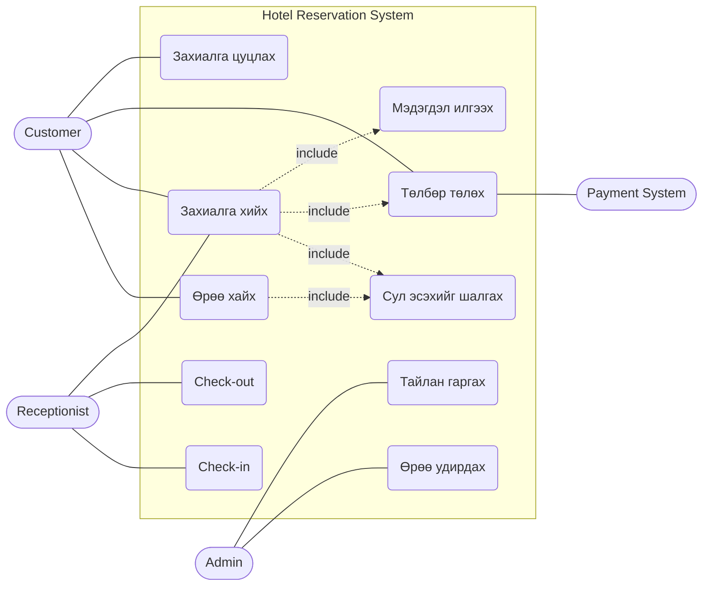
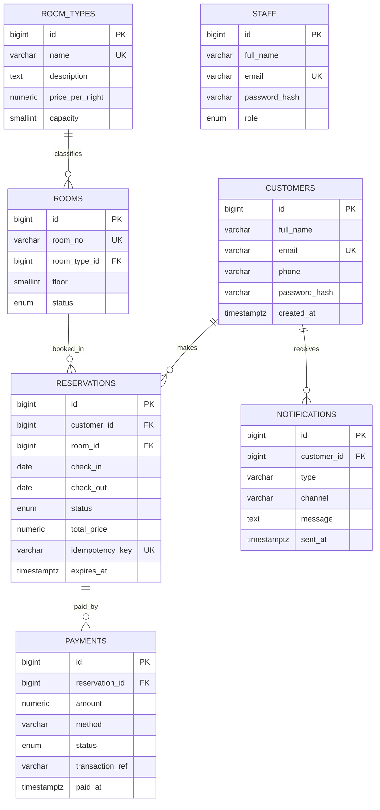
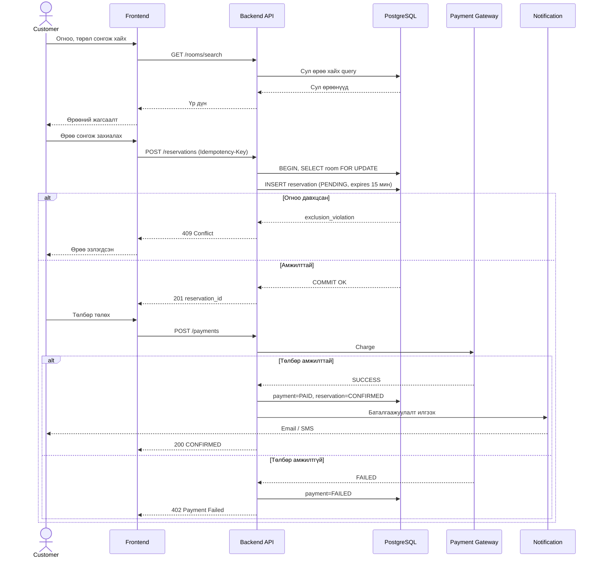
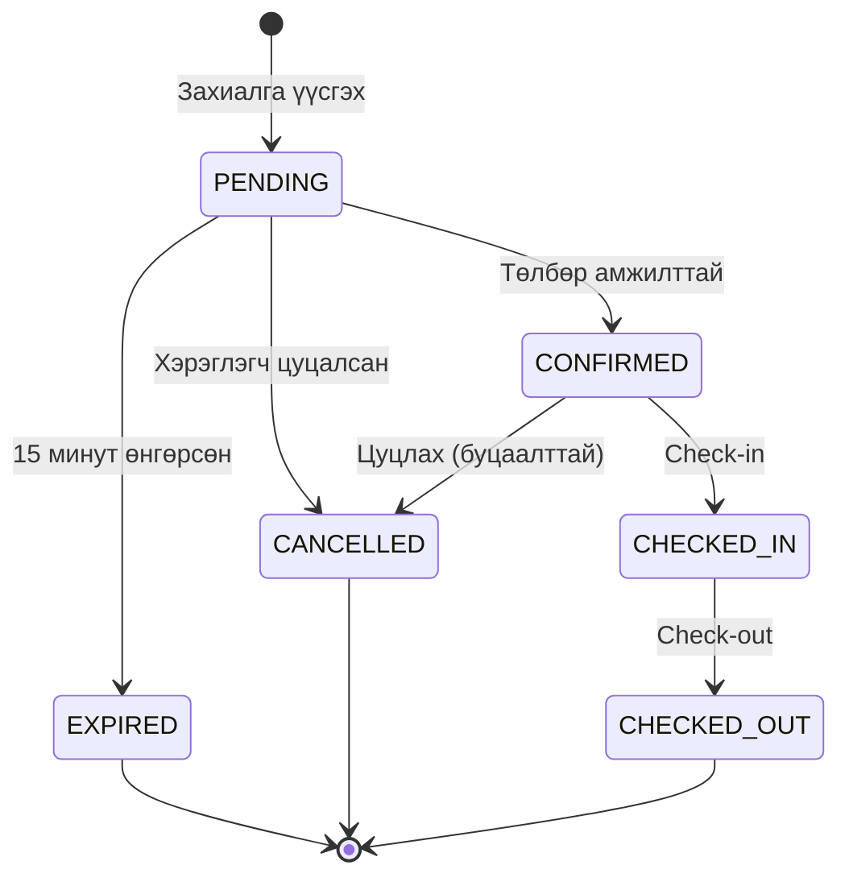
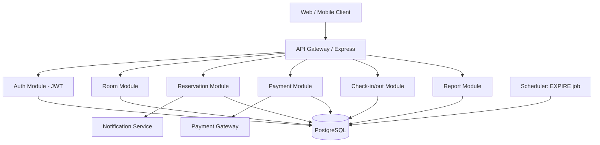

# Mermaid диаграммууд (draw.io-д оруулах)

draw.io дээр: **Arrange → Insert → Advanced → Mermaid...** цэс рүү код хуулж Insert дарна.
(Эсвэл https://mermaid.live дээр шалгаад, SVG/PNG-ээр татаж болно.)

---

## 1. Use Case diagram

---

## 2. ER diagram

---

## 3. Sequence diagram: Өрөө захиалах

---

## 4. State diagram: Захиалгын төлөв

---

## 5. Component / Architecture diagram

